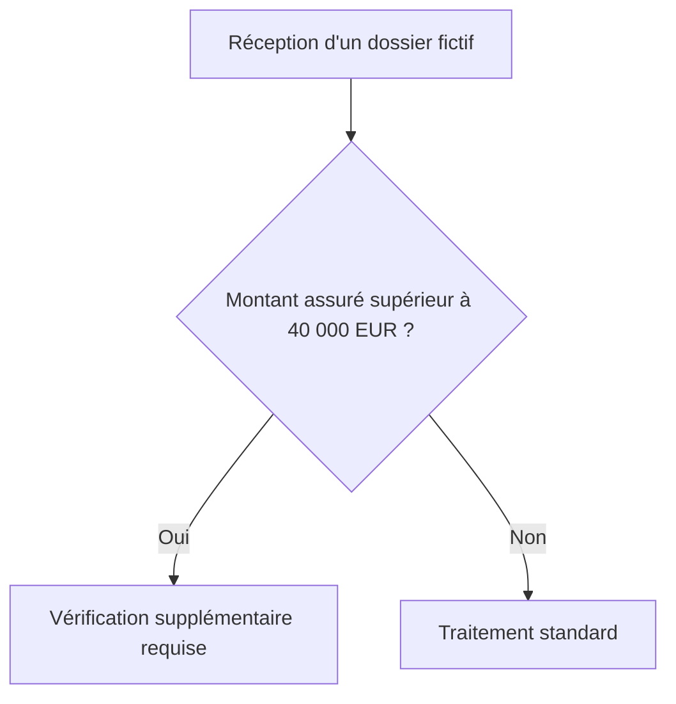

# Automatisation du traitement des dossiers d'assurance

**Automatisation des processus métier | n8n**

## Présentation du projet

Ce projet illustre comment l'automatisation peut simplifier le traitement initial des dossiers d'assurance en appliquant des règles métier prédéfinies.

Développé avec **n8n**, ce workflow permet d'analyser le montant assuré d'un dossier fictif et de lui attribuer automatiquement un statut de traitement.

## Problématique métier

Dans le secteur de l'assurance, certaines opérations administratives reposent sur des tâches répétitives : vérification des informations, application de règles de gestion et orientation des dossiers.

Ces opérations, lorsqu'elles sont effectuées manuellement, peuvent mobiliser du temps et entraîner des erreurs.

L'objectif est donc d'automatiser les tâches prévisibles afin de permettre aux collaborateurs de se concentrer sur les situations nécessitant une analyse plus approfondie.

## Solution développée

J'ai conçu et testé un workflow n8n reposant sur une règle de gestion simple :

- **Montant assuré supérieur à 40 000 € :** attribution du statut « Vérification supplémentaire requise ».
- **Montant assuré inférieur ou égal à 40 000 € :** attribution du statut « Traitement standard ».

Le workflow conserve les informations initiales du dossier et ajoute automatiquement le statut correspondant.

## Résultats des tests

Les deux scénarios ont été testés avec succès à partir de données fictives.

Le prototype démontre la possibilité d'automatiser l'orientation initiale des dossiers selon des critères prédéfinis, sans intervention manuelle lors de l'exécution.

## Technologies utilisées

- **n8n :** conception et exécution des workflows.
- **JSON :** structuration et transmission des données.
- **Logique conditionnelle :** application de règles métier.

## État du projet

Prototype fonctionnel développé et testé localement.

Cette première version repose sur une automatisation par règles, sans intégration d'intelligence artificielle.

**Prochaines évolutions envisagées :** traitement de plusieurs dossiers, intégration d'une analyse assistée par IA et ajout de contrôles avec validation humaine.

*Le code et les configurations internes du workflow sont conservés dans un environnement privé.*

## Architecture fonctionnelle

